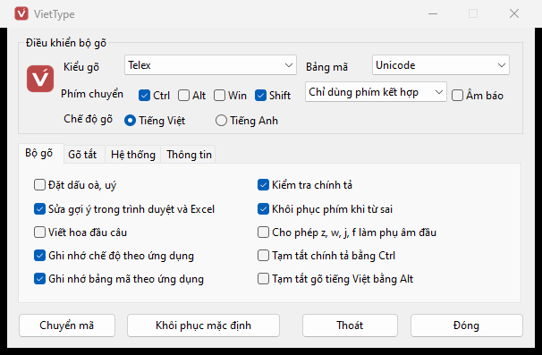
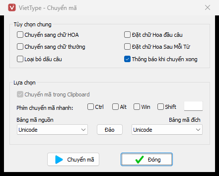

# VietType

VietType là bộ gõ tiếng Việt cho Windows 64-bit, chạy trực tiếp bằng tệp `VietType.exe`. Ứng dụng có sáu kiểu gõ, 18 bảng mã, gõ tắt, chuyển mã qua clipboard và cập nhật từ GitHub.

[Tải VietType cho Windows x64](https://github.com/phuonglam505/VietType/releases/latest)



## Bắt đầu

1. Tải `VietType.exe` từ trang **Releases** và lưu vào thư mục bạn muốn dùng lâu dài.
2. Nếu đang chạy một bản VietType cũ, nhấp phải biểu tượng **V/E** ở khay hệ thống và chọn **Thoát**, rồi mở tệp vừa tải.
3. Chọn **Tiếng Việt**, **Telex** và **Unicode**. Mở Notepad hoặc ứng dụng cần nhập văn bản, rồi gõ `tieengs Vieetj` để được **tiếng Việt**.
4. Nhấn **Ctrl + Shift** theo mặc định để chuyển Việt/Anh. Bạn cũng có thể nhấp biểu tượng **V** đỏ hoặc **E** xanh ở khay hệ thống.
5. Chọn **Đóng** để thu cửa sổ về khay và tiếp tục gõ. Chọn **Thoát** để dừng VietType.

## Kiểu gõ và bảng mã

| Kiểu gõ | Cách dùng |
| --- | --- |
| **VNI** | Dùng phím số để thêm dấu. Ví dụ `tieng61` → **tiếng**. |
| **Telex - giữ từ tiếng Anh** | Dùng phím chữ như Telex. Một số từ tiếng Anh phổ biến, chẳng hạn `more`, được giữ nguyên khi kết thúc từ. |
| **Telex** | Dùng phím chữ để thêm dấu. Ví dụ `tieengs` → **tiếng**. |
| **Simple Telex** | Dùng các phím chữ Telex với bộ phím rút gọn. |
| **VNI + Telex** | Trộn phím dấu VNI và Telex trong cùng một từ. Ví dụ `tie6ngs` hoặc `tieeng1` → **tiếng**. |
| **VNI + Telex - giữ từ tiếng Anh** | Gõ kết hợp và giữ các từ tiếng Anh phổ biến khi kết thúc từ. |

Chọn **Unicode** cho văn bản thông thường. Với tài liệu cũ hoặc một quy trình cần định dạng cụ thể, chọn bảng mã tương ứng trong cửa sổ chính, menu khay hoặc công cụ **Chuyển mã**.

| Bảng mã và định dạng | | |
| --- | --- | --- |
| Unicode | Unicode tổ hợp | Windows CP1258 |
| VNI Windows | TCVN3 (ABC) | VIQR |
| UTF-8 Literal | X UTF-8 | Unicode C String |
| NCR Decimal | NCR Hex | VISCII |
| VPS | BK HCM 1 | BK HCM 2 |
| Vietware X | Vietware F | VNU |

Các bảng mã cũ có thể cần phông chữ tương ứng. UTF-8 Literal và X UTF-8 dùng cùng dạng mã hóa UTF-8 trong VnConv. TCVN3 và Vietware F có thể mất dạng chữ hoa của một số ký tự có dấu khi chuyển ngược về Unicode.

## Phím chuyển và tùy chọn bộ gõ

Ở đầu cửa sổ, chọn **Tiếng Việt** hoặc **Tiếng Anh**. Để đổi phím chuyển, đánh dấu **Ctrl**, **Alt**, **Win** hoặc **Shift**, rồi chọn một phím bổ sung hoặc **Chỉ dùng phím kết hợp**. Bật **Âm báo** nếu muốn nghe tín hiệu lúc chuyển.

Tab **Bộ gõ** có các tùy chọn sau:

| Tùy chọn | Tác dụng |
| --- | --- |
| Đặt dấu oà, uý | Dùng cách đặt dấu như `hoà`, `tuý`. |
| Kiểm tra chính tả | Kiểm tra cấu trúc âm tiết trong khi gõ. |
| Khôi phục phím khi từ sai | Trả về các phím đã gõ khi bộ gõ xác định từ sai cấu trúc. |
| Sửa gợi ý trong trình duyệt và Excel | Hỗ trợ nhập liệu ở ô có gợi ý tự động. |
| Viết hoa đầu câu | Tự viết hoa chữ cái đầu câu. |
| Cho phép z, w, j, f làm phụ âm đầu | Chấp nhận thêm các chữ này ở đầu từ. |
| Ghi nhớ chế độ theo ứng dụng | Ghi nhớ lựa chọn tiếng Việt hoặc tiếng Anh theo cửa sổ ứng dụng. |
| Ghi nhớ bảng mã theo ứng dụng | Khôi phục bảng mã đã chọn khi quay lại ứng dụng. |
| Tạm tắt chính tả bằng Ctrl | Dùng Ctrl để tạm ngừng kiểm tra chính tả. |
| Tạm tắt gõ tiếng Việt bằng Alt | Dùng Alt để tạm ngừng xử lý tiếng Việt. |

## Gõ tắt

1. Mở tab **Gõ tắt**, bật **Cho phép gõ tắt** và chọn **Mở bảng gõ tắt**.
2. Nhập **Từ gõ tắt** và **Nội dung đầy đủ**, rồi chọn **Thêm**. Ví dụ, thêm `cty` → `Công ty`. Trong trình soạn thảo, gõ `cty` rồi nhấn **Space** để mở rộng.
3. Chọn một mục trong bảng để sửa hoặc xóa. Dùng **Nạp từ file…** và **Xuất ra file…** để nhập hoặc sao lưu bảng dạng `.txt`.

Có thể bật gõ tắt trong chế độ tiếng Anh và đổi kiểu viết hoa theo phím tắt. Tab này cũng có tùy chọn **Gõ nhanh Telex** (`cc` → `ch`, `gg` → `gi`), gõ nhanh phụ âm đầu (`f` → `ph`, `j` → `gi`, `w` → `qu`) và phụ âm cuối (`g` → `ng`, `h` → `nh`, `k` → `ch`).

## Chuyển mã văn bản



1. Sao chép văn bản cần chuyển vào clipboard.
2. Mở **Chuyển mã**, rồi chọn **Bảng mã nguồn** và **Bảng mã đích**. Ví dụ, chọn **TCVN3 (ABC)** → **Unicode** để chuyển một đoạn văn bản cũ.
3. Bấm **Chuyển mã**, rồi dán kết quả vào tài liệu. Nút **Đảo** đổi chỗ bảng mã nguồn và đích.

Công cụ còn hỗ trợ chuyển chữ HOA, chữ thường, viết hoa đầu câu, viết hoa từng từ, bỏ dấu tiếng Việt và thông báo sau khi chuyển. Đặt **Phím chuyển mã nhanh** trong công cụ, hoặc chọn **Chuyển mã nhanh** ở menu khay để dùng lại cấu hình vừa lưu. Các bảng mã mở rộng được chuyển qua văn bản thuần trong clipboard.

## Tùy chọn Windows và menu khay

Tab **Hệ thống** có các tùy chọn:

- **Khởi động cùng Windows**, **Hiện cửa sổ khi khởi động** và **Tạo lối tắt trên Desktop**.
- **Biểu tượng khay hiện đại** để đổi kiểu biểu tượng.
- **Hỗ trợ ứng dụng Metro**, **Sửa lỗi gõ trên Chromium (beta)** và **Gửi ký tự qua clipboard** để điều chỉnh cách nhập trong từng môi trường.
- **Bật quyền quản trị ở lần mở sau** cho trường hợp cần gõ trong ứng dụng chạy với quyền quản trị.
- **Kiểm tra bản mới khi khởi động** để tự kiểm tra GitHub khi mở VietType.

Nhấp phải biểu tượng khay để đổi chế độ, chọn kiểu gõ hoặc bảng mã, mở bảng gõ tắt, mở công cụ chuyển mã, chuyển mã nhanh, mở cửa sổ chính hoặc thoát. Nút **Khôi phục mặc định** đặt lại thiết lập và giữ bảng gõ tắt.

## Cập nhật từ GitHub

1. Bật **Hệ thống → Kiểm tra bản mới khi khởi động**.
2. Khi mở VietType, ứng dụng kiểm tra Release mới nhất. Nếu có bản mới với tệp cập nhật hợp lệ, VietType hiện thông báo và bật nút **Cập nhật** trong tab **Thông tin**. Nút mờ khi chưa có bản cập nhật.
3. Bấm **Thông tin → Cập nhật**. VietType tải `VietType.exe`, xác minh SHA-256, thay tệp thực thi và mở lại ứng dụng. Bản dự phòng được giữ đến khi bản mới khởi tạo được bộ gõ và biểu tượng khay.

Các tùy chọn và bảng gõ tắt được lưu theo tài khoản Windows, nên vẫn có thể sử dụng sau khi thay EXE.

## Mã nguồn, giấy phép và build

VietType có sử dụng mã nguồn **OpenKey**. Phần chuyển mã mở rộng dùng **VnConv từ UniKey**, được biên dịch cùng ứng dụng. Xem [giấy phép VietType](LICENSE) và [nguồn gốc, giấy phép VnConv](third_party/vnconv/README.md).

- `engine/` chứa lõi gõ, gõ tắt và chuyển mã.
- `win32/VietType/` chứa giao diện, tích hợp bàn phím Windows, khay hệ thống và cập nhật.
- `third_party/vnconv/` chứa mã chuyển đổi bảng mã mở rộng.

### Build Release x64

Cần Visual Studio Build Tools 2022 với bộ công cụ C++, Windows SDK và CMake 3.21 trở lên.

```powershell
cmake -S . -B build -G 'Visual Studio 17 2022' -A x64
cmake --build build --config Release
.\build\Release\VietType.exe
```

### Phát hành trên GitHub

Cập nhật số phiên bản trong `CMakeLists.txt` và `win32/VietType/VietType.rc` trước khi build. Tạo Release chính thức từ đúng commit bằng tag `vX.Y.Z`, ví dụ `v0.2.19`, và đính kèm tệp Windows x64 với tên `VietType.exe`. Giữ mã nguồn và giấy phép trong cùng tag.
