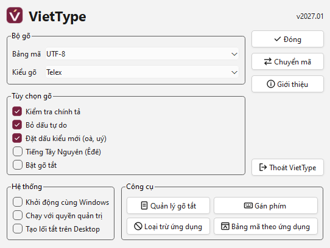

# VietType — gõ tiếng Việt

VietType là bộ gõ tiếng Việt mã nguồn mở phát triển từ [VnKey](https://vnkey.app/). Bản **v2027.01** dành cho Windows dùng lõi Rust và cửa sổ cài đặt C++/Qt 6. Bản Windows hỗ trợ Telex, VNI, gõ tắt, kiểm tra chính tả, chuyển mã Clipboard và cấu hình theo ứng dụng.



## Tải và cài đặt

### Windows 10/11 x64

1. Tải `VietType-v2027.01-Windows-x64-Install.zip` trong mục **Assets** của [GitHub Releases](https://github.com/phuonglam505/VietType/releases).
2. Giải nén toàn bộ gói. Nếu VietType đang chạy, chọn **Thoát VietType** ở khay hệ thống.
3. Chạy `Install-VietType.cmd` để cài cho tài khoản Windows hiện tại, rồi mở **VietType** từ Start. Bạn cũng có thể chạy trực tiếp `VietType.exe` trong thư mục đã giải nén.
4. Trong **Bộ gõ**, chọn **Telex** hoặc **VNI**. Dùng `Ctrl+Shift` để chuyển Việt/Anh, hoặc đổi phím này trong **Gán phím**. Biểu tượng **V** màu đỏ rượu vang là chế độ tiếng Việt, **E** màu xanh là chế độ tiếng Anh.

Nếu Windows báo thiếu Visual C++ Runtime, chạy `vc_redist.x64.exe` kèm trong gói. Các cửa sổ công cụ cần Microsoft Edge WebView2 Runtime. Có thể tạo lối tắt Desktop trong nhóm **Hệ thống**.

### Linux và macOS — bản thử nghiệm

Mã nguồn có hai thành phần Linux cho **Fcitx 5** và **IBus**, cùng ứng dụng thanh menu macOS dựa trên **CGEventTap**. Chúng dùng lõi Rust chung và giao diện theo nền tảng. Quy trình GitHub Actions tạo gói Debian 12 amd64 và ảnh đĩa macOS Universal. Cần kiểm thử nhập liệu trên máy đích trước khi công bố các gói này là bản ổn định.

| Nền tảng | Gói cần tạo | Cách kích hoạt |
| --- | --- | --- |
| Debian 12 amd64, Fcitx 5 | `viettype-fcitx5_2027.1.0_amd64.deb` | Cài gói, đăng xuất rồi đăng nhập, mở cấu hình Fcitx 5 và thêm **VietType Vietnamese**. |
| Debian 12 amd64, IBus | `viettype-ibus_2027.1.0_amd64.deb` | Cài gói, đăng xuất rồi đăng nhập, mở **Input Sources** của hệ thống hoặc `ibus-setup` và thêm **VietType Vietnamese**. |
| macOS Intel và Apple Silicon | `VietType-v2027.01-macOS-Universal.dmg` | Mở DMG, kéo **VietType** vào **Applications**, mở ứng dụng và cấp quyền **Accessibility** trong **Privacy & Security**. Bản thử nghiệm dùng chữ ký ad hoc và chưa được Apple notarize. |

Chọn gói Linux tương ứng với bộ quản lý nhập liệu đang dùng. Ví dụ với Fcitx 5:

```sh
sudo apt install ./viettype-fcitx5_2027.1.0_amd64.deb
```

## Biên dịch

### Windows

Cần MSVC x64 và Windows SDK, Rust MSVC, CMake 3.21 trở lên và Qt Widgets 6.5 trở lên cho MSVC x64. Thay đường dẫn Qt bằng đường dẫn thực tế:

```powershell
cmake -S . -B build -DCMAKE_PREFIX_PATH="C:/Qt/6.8.3/msvc2022_64"
cmake --build build --config Release
cmake --install build --config Release --prefix dist
.\dist\bin\VietType.exe
```

Để dựng bản Debug, dùng `--config Debug` ở cả lệnh dựng và lệnh cài.

### Linux và macOS

Trong kho GitHub, mở **Actions → Build Linux and macOS packages → Run workflow**. Khi lần chạy hoàn tất, tải gói tương ứng từ **Artifacts**. Quy trình và lệnh dựng nằm trong [.github/workflows/platform-packages.yml](.github/workflows/platform-packages.yml). [Hướng dẫn chạy workflow thủ công của GitHub](https://docs.github.com/en/actions/how-tos/manage-workflow-runs/manually-run-a-workflow)

Chạy bài kiểm thử lõi gõ trên máy có Rust:

```sh
cargo test --locked --manifest-path vnkey-engine/Cargo.toml
```

## Giấy phép và liên hệ

VietType dùng [GNU GPL-3.0-or-later](LICENSE). Dự án giữ lịch sử và ghi nhận công sức của MarixDev cùng các cộng tác viên VnKey. [Lịch sử thay đổi gốc](CHANGELOG.md)

Gửi lỗi qua [GitHub Issues](https://github.com/phuonglam505/VietType/issues) hoặc email **hophuonglam@outlook.com**.
