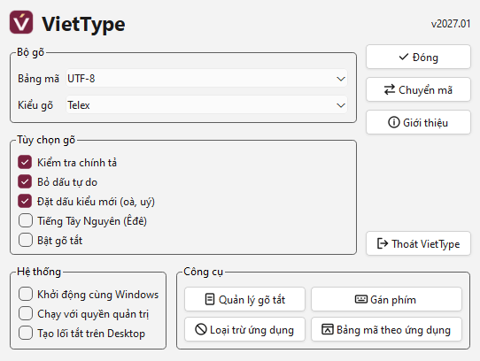

# VietType v2027.01 — Bộ gõ tiếng Việt cho Windows

VietType v2027.01 là bản Windows x64 phát triển từ bộ gõ VnKey, với cửa sổ cài đặt C++/Qt 6 và lõi xử lý tiếng Việt bằng Rust.

## Tính năng

- Gõ Telex và VNI, kiểm tra chính tả, đặt dấu kiểu mới và dùng bảng gõ tắt.
- Chuyển Việt/Anh từ phím tắt hoặc biểu tượng khay hệ thống. **V** đỏ rượu vang là tiếng Việt, **E** xanh là tiếng Anh.
- Chuyển mã Clipboard, chọn bảng mã hoặc loại trừ ứng dụng, và tạo lối tắt Desktop.

## Cài đặt trên Windows 10/11 x64

1. Tải **VietType-v2027.01-Windows-x64-Install.zip** trong phần **Assets** và giải nén toàn bộ.
2. Thoát VietType nếu đang chạy, rồi mở `Install-VietType.cmd`. Sau khi cài, mở **VietType** từ Start. Để chạy bản portable, mở `VietType.exe` ngay trong thư mục giải nén.
3. Chọn **Telex** hoặc **VNI** trong cửa sổ cài đặt, rồi thử gõ trong Notepad.

Các cửa sổ công cụ dùng Microsoft Edge WebView2 Runtime. Gói kèm trình cài Visual C++ Redistributable nếu Windows báo thiếu thư viện. Bộ gõ Windows trong gói này được biên dịch ở cấu hình Debug, giao diện Qt ở cấu hình Release.

## Tiến độ Linux và macOS

Kho mã nguồn có bản thử nghiệm cho Fcitx 5, IBus và macOS Intel/Apple Silicon. Dùng workflow **Build Linux and macOS packages** để tạo gói `.deb` và `.dmg` phục vụ kiểm thử. Gói phát hành này cung cấp bản Windows x64.

Giấy phép **GPL-3.0-or-later**. Dự án gốc [vnkey](https://vnkey.app/). Báo lỗi qua [GitHub Issues](https://github.com/phuonglam505/VietType/issues).
